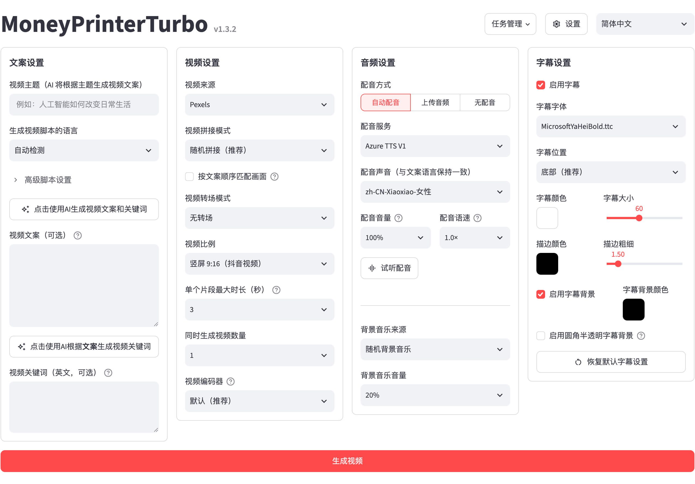
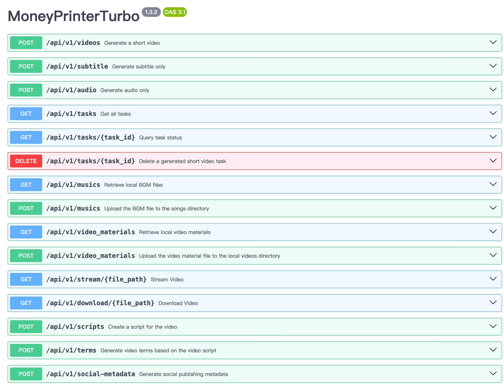

<div align="center">

# 🎬 WebUI - AI Short Video Generator 💸

### One-Click Automated Short Video Generation with WebUI & REST API

Generate engaging, high-definition short videos for **YouTube Shorts, TikTok, and Instagram Reels** simply by providing a **topic** or **prompt**. The engine automatically generates scripts, synthesizes natural voiceover, finds and stitches stock or AI-generated footage, adds timed animated subtitles, and layers background music.

[](https://github.com/Kaushikrudra/Webui)
[](https://www.python.org/)
[](https://streamlit.io/)
[](https://fastapi.tiangolo.com/)
[](https://www.docker.com/)
[](LICENSE)

[Features](#-key-features) • [Preview](#-preview) • [Quick Start](#-quick-start) • [API Keys & Security](#-configuration--api-keys-security) • [Docker](#-docker-deployment) • [API Docs](#-api-service)

</div>

---

## 🖥️ Preview

<div align="center">

### Interactive Streamlit WebUI


### High Performance REST API


</div>

---

## ✨ Key Features

- **🧠 Multi-LLM Script Generation**
  - Works with leading models: **OpenAI (GPT-4o, GPT-3.5), Anthropic Claude, Google Gemini, DeepSeek, Qwen, Moonshot/Kimi, xAI Grok, Ollama (local)**, and OpenAI-compatible gateways.
  - Generates hooks, pacing, video scripts, and optimized video search terms automatically.

- **🗣️ Natural Voiceover & Text-to-Speech (TTS)**
  - **Edge-TTS**: 100% Free, high-quality neural voices with zero API key requirement.
  - Also supports Azure Speech, SiliconFlow, ElevenLabs, Xiaomi MiMo, MiniMax, Fish Audio, and custom TTS audio files.

- **🎥 Multi-Source Footage & AI Video**
  - **Stock Footage (Free)**: Automated search and download from **Pexels**, **Pixabay**, and **Coverr**.
  - **AI Video Generation**: Integrated with Metaso MiniMax H3, Seedance, Wan, WaveSpeed, MuAPI, and OpenAI-compatible image-to-video generators.
  - **Custom Media**: Upload your own local videos, photos, and music clips.

- **🎵 Timed Subtitles & Dynamic Audio**
  - Automatic speech-to-text timing with customizable subtitle fonts, colors, stroke borders, animations, and positions.
  - Automatic volume mixing for voiceover and background music (BGM).

- **📐 Multi-Aspect Ratio Export**
  - **9:16 (1080×1920)**: Optimized for TikTok, Instagram Reels, and YouTube Shorts.
  - **16:9 (1920×1080)**: Landscape for standard YouTube videos and presentations.
  - **1:1 (1080×1080)**: Square format for Instagram posts and feeds.

- **🚀 Flexible Workflows**
  - **WebUI**: User-friendly browser interface built with Streamlit.
  - **REST API**: Automated programmatic batch processing built with FastAPI and Uvicorn.
  - **CLI**: Direct command-line generation for terminal workflows.

---

## 🔒 Configuration & API Keys Security

> [!IMPORTANT]
> **API Key Safety Notice:**
> - Never hardcode or commit your private API keys to GitHub.
> - The application keeps all credentials in `config.toml`, which is listed in `.gitignore` to prevent accidental exposure.
> - You can also use environment variables instead of editing `config.toml`.
> - **Edge-TTS** and basic local features require **no API key**!

### Setting Up Your Private Configuration

1. Copy the example configuration template:
   ```bash
   cp config.example.toml config.toml
   ```

2. Open `config.toml` in your editor and insert your API keys in the placeholder fields:

   ```toml
   # =============================================================================
   # API Keys Configuration (Keep this file private!)
   # =============================================================================
   [app]

   # --- LLM Providers (Choose any provider you use) ---
   openai_api_key = "your_openai_api_key_here"         # https://platform.openai.com/api-keys
   gemini_api_key = "your_gemini_api_key_here"         # https://aistudio.google.com/app/apikey
   deepseek_api_key = "your_deepseek_api_key_here"     # https://platform.deepseek.com/api_keys
   anthropic_api_key = "your_anthropic_api_key_here"   # https://console.anthropic.com/
   qwen_api_key = "your_qwen_api_key_here"             # https://dashscope.console.aliyun.com/

   # --- Free Stock Footage Providers ---
   # Pexels API: https://www.pexels.com/api/
   pexels_api_keys = [
       "your_pexels_api_key_here"
   ]

   # Pixabay API: https://pixabay.com/api/docs/
   pixabay_api_keys = [
       "your_pixabay_api_key_here"
   ]

   # --- AI Video Generation (Optional) ---
   # metaso_minimax_api_key = "your_metaso_key_here"
   # volcengine_seedance_api_key = "your_seedance_key_here"
   # muapi_api_key = "your_muapi_key_here"
   ```

3. Save `config.toml`. Git will automatically ignore `config.toml`, so your secrets remain secure on your machine.

---

## 🚀 Quick Start

### Prerequisites

- **Python 3.11** (Recommended)
- **FFmpeg**: Required for video rendering and audio extraction
  - **Ubuntu / Debian**:
    ```bash
    sudo apt update && sudo apt install -y ffmpeg
    ```
  - **macOS**:
    ```bash
    brew install ffmpeg
    ```
  - **Windows**:
    Download from [gyan.dev](https://www.gyan.dev/ffmpeg/builds/) or install via `winget install Gyan.FFmpeg`.
- **ImageMagick** (Optional, for advanced subtitle styling):
  - **Ubuntu / Debian**: `sudo apt install -y imagemagick`
  - **macOS**: `brew install imagemagick`

---

### Installation

1. **Clone the repository:**
   ```bash
   git clone https://github.com/Kaushikrudra/Webui.git
   cd Webui
   ```

2. **Create and activate a virtual environment:**
   ```bash
   python3 -m venv .venv
   source .venv/bin/activate
   # On Windows: .venv\Scripts\activate
   ```

3. **Install dependencies:**
   Using `pip`:
   ```bash
   pip install --upgrade pip
   pip install -r requirements.txt
   ```
   Or using `uv` (faster):
   ```bash
   uv sync
   ```

4. **Initialize configuration:**
   ```bash
   cp config.example.toml config.toml
   ```

---

### Running the Application

#### 1. Launch WebUI (Streamlit Interface)

- **Linux / macOS:**
  ```bash
  ./webui.sh
  ```
- **Windows:**
  ```cmd
  webui.bat
  ```
- **Direct Python command:**
  ```bash
  python -m streamlit run webui/Main.py
  ```

Open your browser and navigate to: **`http://localhost:8501`**

#### 2. Launch FastAPI Backend Server

If you want to use the REST API:
```bash
python main.py
```
- API Server: `http://localhost:8080`
- Interactive OpenAPI / Swagger Docs: `http://localhost:8080/docs`

#### 3. Run via CLI

To generate videos directly from the command line:
```bash
python cli.py --help
```

---

## 🐳 Docker Deployment

You can deploy the entire stack using Docker without manually installing Python or FFmpeg:

```bash
# Build and run using Docker Compose
docker compose up -d

# View live container logs
docker compose logs -f
```

- WebUI will be available at: `http://localhost:8501`
- API docs will be available at: `http://localhost:8080/docs`

For GPU-accelerated Docker deployment:
```bash
docker compose -f docker-compose.gpu.yml up -d
```

---

## 📁 Project Structure

```text
Webui/
├── app/                      # Backend application modules
│   ├── config/               # Configuration loader and parser
│   ├── controllers/          # API route controllers
│   ├── models/               # Pydantic schemas and database models
│   ├── services/             # Core video generation pipeline (LLM, TTS, Video, Subtitle)
│   └── utils/                # Helper utilities and file handlers
├── docs/                     # Documentation assets and screenshots
├── resource/                 # Fonts, sample music tracks, and visual templates
├── webui/                    # Streamlit WebUI pages and components
│   └── Main.py               # Main WebUI application entrypoint
├── cli.py                    # Command-line interface
├── config.example.toml       # Template configuration file (version controlled)
├── config.toml               # Your private configuration (git-ignored)
├── docker-compose.yml        # Docker composition file
├── Dockerfile                # Docker build file
├── main.py                   # FastAPI application server entrypoint
├── requirements.txt          # Python pip dependencies
├── webui.bat                 # Windows one-click start script
└── webui.sh                  # Linux/macOS one-click start script
```

---

## 🛠️ Troubleshooting & Tips

- **Edge TTS Connection Error:**
  Edge TTS connects to Microsoft cloud servers. If your network requires a proxy or experience timeouts, increase `edge_tts_timeout = 60` in `config.toml`.
- **FFmpeg not detected:**
  Ensure `ffmpeg` is accessible in your system `PATH`. Run `ffmpeg -version` in your terminal to verify.
- **Port Conflict:**
  The `webui.sh` script automatically detects free ports in the range `8501-8599` if port 8501 is busy.

---

## 🤝 Contributing

Contributions, issues, and feature requests are welcome!
Feel free to open an issue or submit a Pull Request on the [GitHub Repository](https://github.com/Kaushikrudra/Webui).

---

## 📄 License

This project is licensed under the [MIT License](LICENSE).
